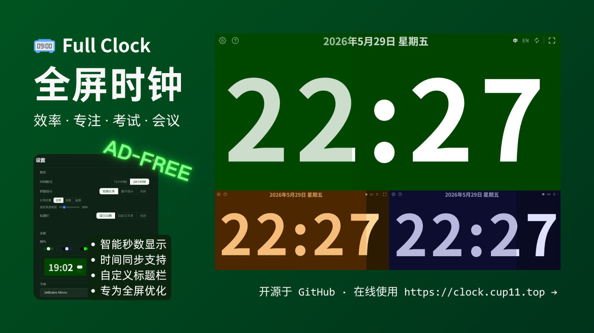

# Full Clock - 全屏时钟

 [![zread](https://img.shields.io/badge/Ask_Zread-_.svg?style=flat&color=00b0aa&labelColor=000000&logo=data%3Aimage%2Fsvg%2Bxml%3Bbase64%2CPHN2ZyB3aWR0aD0iMTYiIGhlaWdodD0iMTYiIHZpZXdCb3g9IjAgMCAxNiAxNiIgZmlsbD0ibm9uZSIgeG1sbnM9Imh0dHA6Ly93d3cudzMub3JnLzIwMDAvc3ZnIj4KPHBhdGggZD0iTTQuOTYxNTYgMS42MDAxSDIuMjQxNTZDMS44ODgxIDEuNjAwMSAxLjYwMTU2IDEuODg2NjQgMS42MDE1NiAyLjI0MDFWNC45NjAxQzEuNjAxNTYgNS4zMTM1NiAxLjg4ODEgNS42MDAxIDIuMjQxNTYgNS42MDAxSDQuOTYxNTZDNS4zMTUwMiA1LjYwMDEgNS42MDE1NiA1LjMxMzU2IDUuNjAxNTYgNC45NjAxVjIuMjQwMUM1LjYwMTU2IDEuODg2NjQgNS4zMTUwMiAxLjYwMDEgNC45NjE1NiAxLjYwMDFaIiBmaWxsPSIjZmZmIi8%2BCjxwYXRoIGQ9Ik00Ljk2MTU2IDEwLjM5OTlIMi4yNDE1NkMxLjg4ODEgMTAuMzk5OSAxLjYwMTU2IDEwLjY4NjQgMS42MDE1NiAxMS4wMzk5VjEzLjc1OTlDMS42MDE1NiAxNC4xMTM0IDEuODg4MSAxNC4zOTk5IDIuMjQxNTYgMTQuMzk5OUg0Ljk2MTU2QzUuMzE1MDIgMTQuMzk5OSA1LjYwMTU2IDE0LjExMzQgNS42MDE1NiAxMy43NTk5VjExLjAzOTlDNS42MDE1NiAxMC42ODY0IDUuMzE1MDIgMTAuMzk5OSA0Ljk2MTU2IDEwLjM5OTlaIiBmaWxsPSIjZmZmIi8%2BCjxwYXRoIGQ9Ik0xMy43NTg0IDEuNjAwMUgxMS4wMzg0QzEwLjY4NSAxLjYwMDEgMTAuMzk4NCAxLjg4NjY0IDEwLjM5ODQgMi4yNDAxVjQuOTYwMUMxMC4zOTg0IDUuMzEzNTYgMTAuNjg1IDUuNjAwMSAxMS4wMzg0IDUuNjAwMUgxMy43NTg0QzE0LjExMTkgNS42MDAxIDE0LjM5ODQgNS4zMTM1NiAxNC4zOTg0IDQuOTYwMVYyLjI0MDFDMTQuMzk4NCAxLjg4NjY0IDE0LjExMTkgMS42MDAxIDEzLjc1ODQgMS42MDAxWiIgZmlsbD0iI2ZmZiIvPgo8cGF0aCBkPSJNNCAxMkwxMiA0TDQgMTJaIiBmaWxsPSIjZmZmIi8%2BCjxwYXRoIGQ9Ik00IDEyTDEyIDQiIHN0cm9rZT0iI2ZmZiIgc3Ryb2tlLXdpZHRoPSIxLjUiIHN0cm9rZS1saW5lY2FwPSJyb3VuZCIvPgo8L3N2Zz4K&logoColor=ffffff)](https://zread.ai/cup113/full-clock)

-brightgreen>)

> Full Clock is a clean, ad-free digital clock designed for full-screen use. It supports toggling seconds display, background progress bars, titles, dates, custom colors and fonts — ideal for exam hall countdowns or information displays.
> 
> 全屏时钟是一个纯净无广告的电子时钟，支持全屏显示，可配置性强。支持切换显示秒、背景进度条、标题、日期等，支持修改颜色与字体，适合用于考试电脑显示。
> 
> Built with [Svelte 5](https://svelte.dev/) + [SvelteKit](https://kit.svelte.dev/), styled with [Tailwind CSS v4](https://tailwindcss.com/), internationalized via [inlang](https://inlang.com/) + [Paraglide](https://inlang.com/m/gerre34r/library-inlang-paraglideJs), PWA powered by [vite-plugin-pwa](https://github.com/vite-pwa/vite-plugin-pwa).
> 
> 该项目使用 [Svelte 5](https://svelte.dev/) + [SvelteKit](https://kit.svelte.dev/) 构建，UI 基于 [Tailwind CSS v4](https://tailwindcss.com/)，国际化使用 [inlang](https://inlang.com/) + [Paraglide](https://inlang.com/m/gerre34r/library-inlang-paraglideJs)，PWA 使用 [vite-plugin-pwa](https://github.com/vite-pwa/vite-plugin-pwa)。
> 
> This project is a complete rewrite of the previous [clock](https://github.com/cup113/clock).
> 
> 本项目是[时钟](https://github.com/cup113/clock)的重构升级版。

## Interface / 界面介绍

### Main Screen / 主界面

- **Center / 中央**: Time display / 显示时间
- **Top-left / 左上角**: Settings, Wake Lock, About buttons / 设置、屏幕常亮、关于按钮
- **Top-right / 右上角**: Language switch, Fullscreen button / 语言切换、全屏按钮
- **Top bar / 正上方**: Title (date / custom text / off) / 标题（日期/自定义内容/关闭）

### Settings Panel / 设置界面

Modal dialog with the following categories / 模态弹窗，包含以下设置分类：

1. **Second Style / 秒钟样式** — full-screen bar, top bar, bottom bar, digital, off / 全屏长条、顶部长条、底部条、数字显示、关闭
2. **Progress Bar Opacity / 进度条透明度** — adjust opacity of the progress bar / 调整进度条不透明度
3. **Title Style / 标题样式** — date, custom, off / 日期、自定义、关闭
4. **Colors / 颜色** — background, text, progress bar / 背景色、字体色、进度条色
5. **Font / 字体** — font-family selector / font-family 选择器
6. **Time Sync / 时间同步** — auto-calibrate system clock offset (auto-sync when error <500ms) / 自动校准系统时钟偏差（误差 <500ms 自动同步）
7. **Language / 语言** — 中文 / English

## Usage / 使用方法

1. On first use, click the **Settings** button at the top-left to customize. / 首次使用，点击左上角"设置"按钮，进行个性化设置。
2. After configuration, click **Close** or tap outside the modal to return to the main screen. / 设置完成后，点击"关闭"按钮或点击弹窗外侧返回主界面。
3. Click the **Fullscreen** button at the top-right to toggle full-screen mode. / 点击右上角"全屏"按钮，可以切换全屏显示。
4. Switch between Chinese and English interfaces. / 支持切换中/英文界面。

## Desktop App / 桌面版

The same static build is packaged as a Windows desktop app with [Tauri v2](https://v2.tauri.app/), for machines where installing a PWA is not an option — and because only the native shell can reach a real NTP server (UDP 123).

同一份静态构建通过 [Tauri v2](https://v2.tauri.app/) 打包为 Windows 桌面应用，适合无法安装 PWA 的机器；也只有原生壳能直连 NTP（UDP 123）校准时钟。

- **Two artifacts / 两种产物** — `Full Clock_<version>_x64-setup.exe` (NSIS installer, bootstraps WebView2 if missing) and `FullClock_<version>_x64-portable.zip` (unzip and run) / NSIS 安装包（缺 WebView2 时可自动补装）与便携版（解压即用）
- **Windows 10/11** — the portable build relies on the system WebView2 runtime / 便携版依赖系统自带 WebView2 运行时
- **Offline first / 离线可用** — assets are embedded in the executable; no network needed to show the clock / 资源内嵌在可执行文件里，断网照常走
- **NTP time sync / NTP 校时** — the desktop build adds `ntp.aliyun.com`, `ntp.tencent.com`, `time.windows.com` and `pool.ntp.org` to the provider set; if UDP is blocked it falls back to the HTTP APIs automatically / 桌面版在时间源中增加四个 NTP 服务器，UDP 被拦时自动回落到 HTTP 时间源
- **No analytics / 无上报** — the desktop CSP blocks the umami script, and only the three time APIs are reachable / 桌面端 CSP 阻断 umami，仅放行三个时间 API
- **Unsigned / 未签名** — expect a SmartScreen warning on first launch / 首次运行会有 SmartScreen 提示

Desktop releases are built by `.github/workflows/desktop-release.yml` on every `v*` tag and attached to the GitHub Release.

桌面版由 `.github/workflows/desktop-release.yml` 在推 `v*` tag 时构建，并挂到 GitHub Release。

## Features / 特性

- **Auto-size clock** / **大屏显示时间** — automatically adapts to window size / 自动适配窗口尺寸
- **Multiple second styles** / **多种秒钟显示样式** — full-screen bar, top bar, bottom bar, digital, off / 全屏长条、顶部长条、底部条、数字、关闭
- **Adjustable progress bar opacity** / **进度条透明度可调**
- **Title bar options** / **标题栏** — date, custom text, off / 支持日期/自定义文字/关闭
- **Custom colors** / **自定义颜色** — background, text, progress bar / 背景、字体、进度条
- **Custom fonts** / **自定义字体** — including CJK fonts / 含中文字体
- **12h/24h format** / **12h/24h 时间格式切换**
- **Fullscreen toggle** / **全屏/退出全屏**
- **Wake Lock support** / **屏幕常亮** — with status indicator / 含状态指示
- **Time sync** / **时间同步** — auto-calibrates system clock offset (auto-applied when error <500ms) / 自动校准系统时钟偏差，误差 <500ms 自动应用
- **Internationalization** / **国际化** — 中文 / English
- **PWA support** / **PWA 支持** — offline access, installable / 离线访问、可安装
- **Desktop app** / **桌面版** — Windows Tauri shell, offline, NTP time sync / Windows Tauri 桌面壳，离线可用，支持 NTP 校时
- **Cross-platform** / **跨平台**
